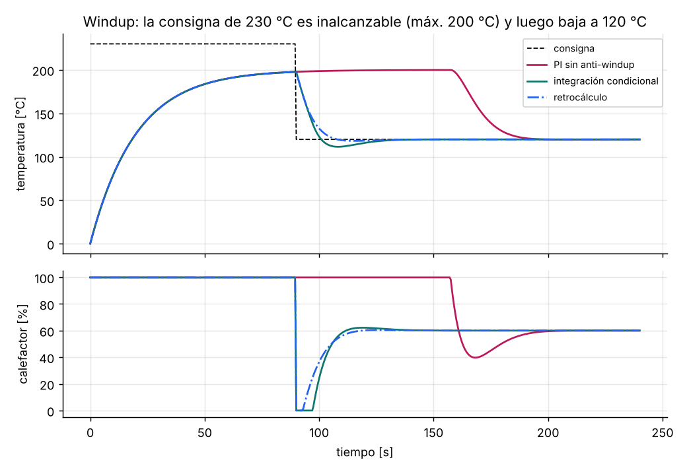

# Open-code — código abierto para sistemas embebidos y automatización

| Proyecto | Qué es |
|---|---|
| [**firmware-starter**](firmware-starter/) | Plantilla de firmware por capas (HAL → drivers → servicios → aplicación) con port para PC y STM32F411, CMake Presets, `clang-format`, `clang-tidy`, pruebas con HAL falso y CI con compilación cruzada |
| [**automation-algorithms**](automation-algorithms/) | Guía práctica en C: antirrebote, rampas para motores paso a paso, máquinas de estados jerárquicas, PID con anti-windup y filtros. Cada algoritmo con explicación, errores típicos, gráficas y pruebas |

## Contribuir

1. Formatea con `clang-format -i` (configuración en [`.clang-format`](.clang-format)).
2. Agrega o actualiza las pruebas; la CI las ejecuta con sanitizers.
3. Mantén C99/C11 portable: sin memoria dinámica en las rutas de tiempo real.

## Autor

**Edinson Daniel Torres Espinosa** — [@Daniel5125](https://github.com/Daniel5125) · Colombia

Licencia MIT; ver [LICENSE](LICENSE).
