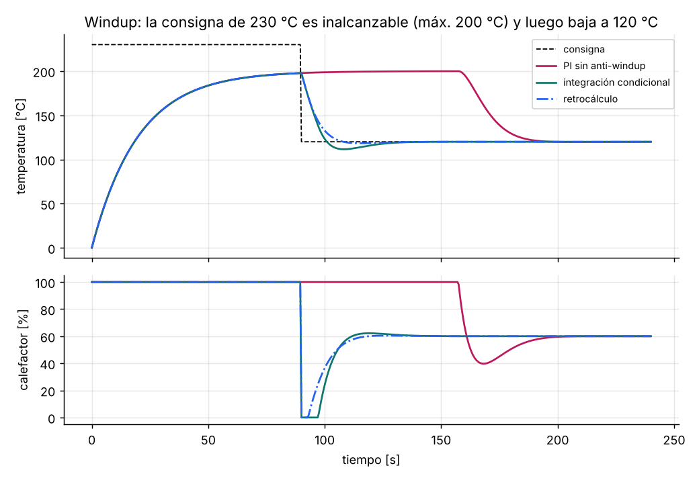

# Algoritmos de automatización — guía práctica en C

Implementaciones listas para microcontroladores de los algoritmos que aparecen
en casi todo proyecto de automatización. Cada una viene con su explicación, los
errores típicos que evita, gráficas generadas con el propio código y pruebas
unitarias.

| Algoritmo | Archivo | Guía |
|---|---|---|
| Antirrebote por integrador (con pulsación larga) | [`debounce.h`](include/aa/debounce.h) | [docs/debounce.md](docs/debounce.md) |
| Rampas de aceleración para motores paso a paso | [`ramp.h`](include/aa/ramp.h) | [docs/ramp.md](docs/ramp.md) |
| Máquina de estados jerárquica (HSM) | [`hsm.h`](include/aa/hsm.h) | [docs/hsm.md](docs/hsm.md) |
| PID con anti-windup, filtro derivativo y transferencia sin salto | [`pid.h`](include/aa/pid.h) | [docs/pid.md](docs/pid.md) |
| Pasa-bajos, limitador de pendiente, histéresis, mediana de 5 | [`filters.h`](include/aa/filters.h) | [docs/filters.md](docs/filters.md) |



## Características

- **C99 portable:** sin memoria dinámica ni dependencias. Compila sin
  advertencias con `-Wall -Wextra -Wconversion -Wdouble-promotion`, para PC y
  ARM Cortex-M.
- **Apto para interrupciones:** la rampa del motor paso a paso usa solo
  aritmética entera en la interrupción.
- **Verificado con pruebas:** cada algoritmo se compara con la física o con el
  comportamiento esperado, con AddressSanitizer y UBSan activos.

## Uso

```bash
cmake -S . -B build -DAA_SANITIZE=ON
cmake --build build
ctest --test-dir build              # pruebas
./build/hsm_traffic_light           # ejemplo: semáforo jerárquico
python tools/plot.py build docs/img # regenera las figuras (requiere matplotlib)
```

Para usarlo en tu proyecto, copia `include/aa` y `src`, o
`add_subdirectory(automation-algorithms)` y `target_link_libraries(app aa)`.

## Pruebas

| Prueba | Qué comprueba |
|---|---|
| Antirrebote | Rebotes reales → un solo evento; interferencia más corta que la ventana → ignorada; pulsación larga emitida una vez |
| Rampa | Número exacto de pasos; velocidad máxima ±1.5 %; tiempo de aceleración v/a ±6 %; tiempo total ±1 %; perfil triangular con aceleración ≠ desaceleración |
| HSM | Orden de entradas y salidas, eventos que suben a los padres, auto-transición externa, subestados iniciales |
| PID | Error nulo en régimen; recuperación tras saturar más de 2 veces más rápida que un PI sin anti-windup; sin pico derivativo; límite de pendiente; paso manual → automático sin salto |
| Filtros | 63 % en t = τ, límites de pendiente asimétricos, histéresis, eliminación de picos |
