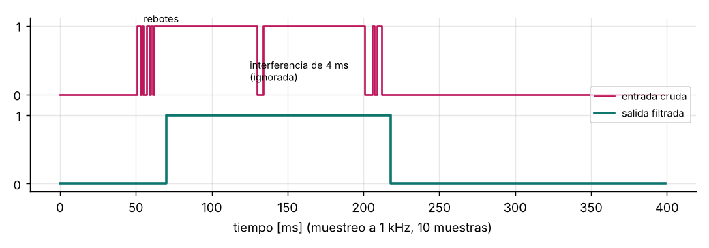

# Antirrebote por software

Un pulsador o un contacto mecánico no cambia de estado limpiamente: rebota
durante 1 a 20 ms. Si se cuenta cada flanco, una sola pulsación se registra
varias veces.



## Algoritmo: integrador

Se muestrea la entrada a intervalo fijo (p. ej. 1 kHz desde un temporizador):

```
si entrada = 1:  contador = min(contador + 1, N)
si entrada = 0:  contador = max(contador − 1, 0)
salida = 1 cuando contador llega a N;  salida = 0 cuando llega a 0
```

| Ventaja | Por qué |
|---|---|
| Filtra rebotes y ruido | Un rebote solo resta una cuenta; hacen falta N muestras netas para cambiar |
| Sin `delay()` | No bloquea el programa |
| Histéresis natural | La salida no oscila entre estados |
| Sirve para entradas industriales | Finales de carrera, flotadores, señales de 24 V con EMI |

## Uso

```c
aa_debounce_t boton;
aa_debounce_init(&boton, 10, 1000, false);   // 10 ms, pulsación larga de 1 s (a 1 kHz)

void tick_1ms(void) {                        // interrupción del temporizador
    switch (aa_debounce_update(&boton, gpio_leer(BOTON))) {
    case AA_BTN_PRESSED:  cola_publicar(EV_INICIO); break;
    case AA_BTN_LONG:     cola_publicar(EV_MENU);   break;
    default: break;
    }
}
```

## Errores típicos

- **Leer el botón en el bucle principal sin periodo fijo:** la ventana de
  antirrebote depende de cuánto tarde el bucle.
- **Antirrebote solo al presionar:** el rebote al soltar genera una pulsación
  fantasma.
- **Ventana demasiado larga (más de 50 ms):** el usuario nota el retardo. Mide
  el rebote real con un osciloscopio.
- **Interrupción por flanco en un pin con rebotes:** se dispara decenas de
  veces. Usa la interrupción solo para despertar y filtra por muestreo.
