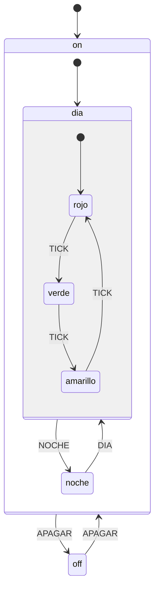

# Máquinas de estados jerárquicas (HSM)

Una máquina de estados plana con muchos estados repite las mismas
transiciones. "Apagar" y "falla" tienen que estar en cada estado. En una HSM
los estados se anidan, y un evento que un estado no maneja sube a su padre.



`APAGAR` se declara una sola vez, en `on`, y funciona desde rojo, verde,
amarillo o noche.

## Semántica (como en los statecharts UML)

1. El evento se entrega al estado actual (una hoja). Si no lo maneja, pasa a
   su padre, y así hasta la raíz.
2. Una transición sale de los estados desde la hoja hasta el **ancestro común
   más bajo** (LCA) y entra desde allí hasta el destino. Si el destino tiene
   subestado inicial, sigue bajando hasta una hoja.
3. Una auto-transición (de un estado a sí mismo) sale del estado y vuelve a
   entrar. Sirve para reiniciar un temporizador en la acción de entrada.

## Uso

```c
static aa_ret_t h_rojo(aa_hsm_t *m, const aa_event_t *e) {
    switch (e->sig) {
    case AA_SIG_ENTRY: luz(ROJO); timer_iniciar(30000); return AA_HANDLED;
    case TICK:         return aa_hsm_transition(m, &verde);
    }
    return AA_UNHANDLED;   // lo demás lo decide el padre
}
static const aa_state_t rojo = {"rojo", &dia, NULL, h_rojo};
```

Traza real del ejemplo (`./build/hsm_traffic_light`):

```
evento NOCHE (estado: amarillo)
  sale de amarillo
  sale de dia
  entra a noche (amarillo intermitente)
```

## Errores típicos

- **Lógica en el `switch` del bucle principal en vez de acciones de entrada y
  salida:** se olvida apagar una salida al cambiar de estado.
- **Llamar a `aa_hsm_dispatch()` desde una interrupción mientras se procesa
  otro evento:** las HSM deben ejecutar un evento a la vez (*run-to-completion*).
  Desde la ISR, encola el evento.
- **Estados con mucha lógica:** el estado decide *qué* hacer; los cálculos van
  en funciones aparte que se puedan probar por separado.
