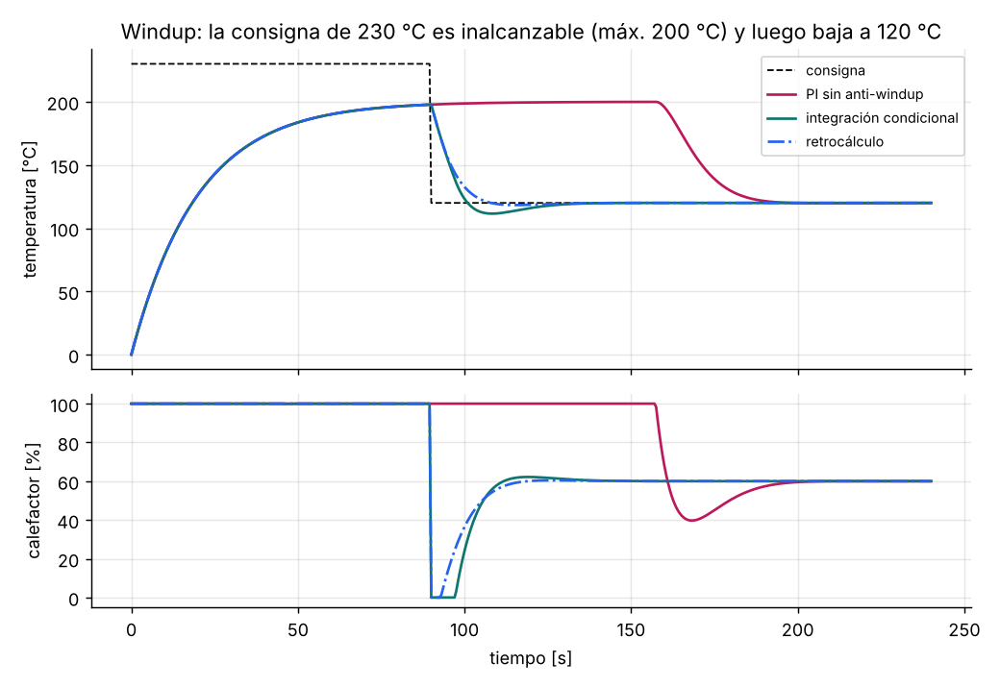

# PID con anti-windup

El PID de libro, `u = Kp·e + Ki·∫e + Kd·de/dt`, falla en una planta real por
tres motivos:

| Problema | Síntoma | Solución en `aa_pid` |
|---|---|---|
| **Windup** | Tras saturar el actuador, el integrador sigue creciendo y la variable se pasa mucho de la consigna, o tarda en volver | Integración condicional o retrocálculo (`kaw`) |
| **Pico derivativo** | Un cambio de consigna produce un pulso enorme en la salida | Derivada sobre la medición, no sobre el error |
| **Ruido amplificado** | La derivada multiplica el ruido de alta frecuencia y el actuador tiembla | Filtro de primer orden en la derivada (`tf`) |



En la figura, la consigna de 230 °C es inalcanzable: el horno llega como
máximo a 200 °C. Sin anti-windup el integrador acumula error durante 90 s, y
cuando la consigna baja a 120 °C el calefactor sigue al 100 % durante **otros
70 s**. Con anti-windup responde de inmediato.

## Ecuaciones (discretizadas con Euler hacia atrás)

```
P = Kp·(b·r − y)                                   b < 1 reduce el sobrepico ante cambios de consigna
D = (Tf·D − Kd·(y − y_prev)) / (Tf + dt)           derivada filtrada de la medición
v = P + I + D ;  u = sat(v)                        salida ideal y salida saturada
I += Ki·dt·e + Kaw·dt·(u − v)                      retrocálculo (Kaw ≈ 1/Ti a 1/√(Ti·Td))
```

Con `kaw = 0` se usa **integración condicional**: no se integra si la salida
está saturada y el error empujaría más hacia la saturación.

## Uso

```c
aa_pid_t lazo;
aa_pid_config_t cfg = {.kp = 2.0f, .ki = 0.2f, .kd = 0.5f, .dt = 0.1f, .tf = 0.05f,
                       .b = 1.0f, .out_min = 0, .out_max = 100, .rate_max = 20, .kaw = 0.5f};
aa_pid_init(&lazo, &cfg);

void tarea_100ms(void) {                     // periodo fijo = dt
    float u = aa_pid_update(&lazo, consigna, leer_temperatura());
    pwm_calefactor(u);
}
```

**Paso manual ↔ automático sin salto:**

```c
aa_pid_set_manual(&lazo, 35.0f);         // el operador fija la salida
aa_pid_set_auto(&lazo, consigna, y);     // el integrador se ajusta: la salida no salta
```

## Sintonía rápida

1. Empieza con un PI (`kd = 0`). Para un proceso de primer orden con tiempo
   muerto (K, τ, θ), usa las reglas SIMC: `Kp = τ / (K·(τc + θ))` y
   `Ki = Kp / min(τ, 4·(τc + θ))`, con `τc ≈ θ`.
2. Añade derivada solo si la planta es lenta y poco ruidosa. Usa `tf ≈ Kd/Kp/10`.
3. Si hay sobrepico ante cambios de consigna pero buen rechazo a
   perturbaciones, baja `b` a 0.5–0.8.

## Errores típicos

- **Periodo de muestreo variable:** `dt` debe ser el real. Llama al PID desde
  un temporizador, no desde el bucle principal.
- **Sintonizar con el actuador saturado:** con la salida al 100 % no se está
  midiendo el lazo.
- **Derivada sobre el error:** cada cambio de consigna golpea el actuador.
- **Olvidar que el integrador también existe en modo manual:** al volver a
  automático la salida salta, salvo que se use `aa_pid_set_auto()`.
