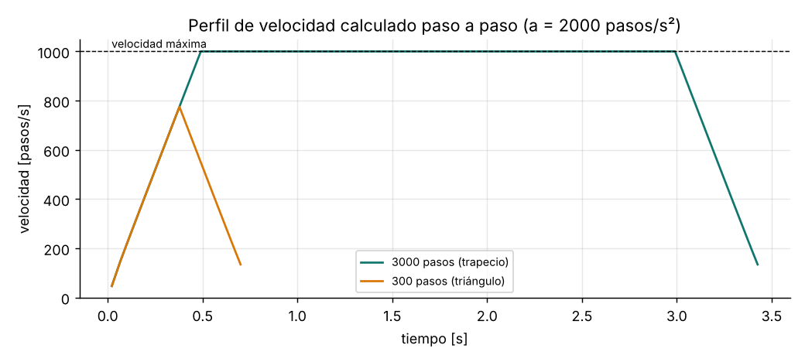

# Rampas de aceleración para motores paso a paso

Un motor paso a paso arrancado directamente a alta velocidad pierde pasos o
se bloquea, porque el rotor no puede seguir el campo. Hay que acelerar y
frenar de forma gradual.



## El problema del tiempo real

El intervalo entre pasos para aceleración constante es
`cₙ = c₀·(√(n+1) − √n)`. Calcular una raíz cuadrada en cada interrupción es
caro en un MCU sin FPU.

**Algoritmo de D. Austin (2005; nota AVR446)**: aproximación por serie de
Taylor que solo usa enteros:

```
c₀ = 0.676 · f · √(2/a)              (una vez por movimiento; 0.676 corrige el primer paso)
cₙ = cₙ₋₁ − 2·cₙ₋₁ / (4n + 1)        (cada paso; el resto de la división se arrastra)
```

Para frenar se usa la misma fórmula con `n` negativo. El planificador
calcula:

- Pasos hasta la velocidad máxima: `v²/(2a)`.
- Punto de cruce si la distancia no alcanza: `pasos · d/(a + d)`. En ese caso
  el perfil es triangular.

## Uso

```c
aa_ramp_t eje_x;
aa_ramp_init(&eje_x, 1000000, 2000.0f, 2000.0f, 1000.0f);   // timer de 1 MHz, pasos/s², pasos/s

void mover(int32_t pasos) {
    gpio_escribir(DIR, pasos >= 0);
    timer_programar(aa_ramp_move(&eje_x, pasos));
}

void TIM_IRQHandler(void) {          // un pulso STEP por interrupción
    gpio_pulso(STEP);
    uint32_t c = aa_ramp_next(&eje_x);
    if (c) timer_programar(c); else timer_detener();
}
```

Verificado: el número exacto de pasos, la velocidad máxima con ±1.5 %, el
tiempo de aceleración v/a con ±6 % y el tiempo total con ±1 %.

## Errores típicos

- **Aceleración excesiva para la carga:** el par disponible cae con la
  velocidad. Mide a qué aceleración se pierden pasos y usa el 50-70 % de ese
  valor.
- **Velocidad máxima por encima de la mitad de la frecuencia del
  temporizador:** `aa_ramp_init()` la rechaza.
- **No frenar al detener por un final de carrera:** para paradas de
  emergencia se corta en seco, pero para el *homing* conviene frenar y
  retroceder.
- **Calcular en coma flotante dentro de la interrupción:** en un Cortex-M0
  sin FPU cada `sqrtf` cuesta microsegundos y limita la velocidad.
