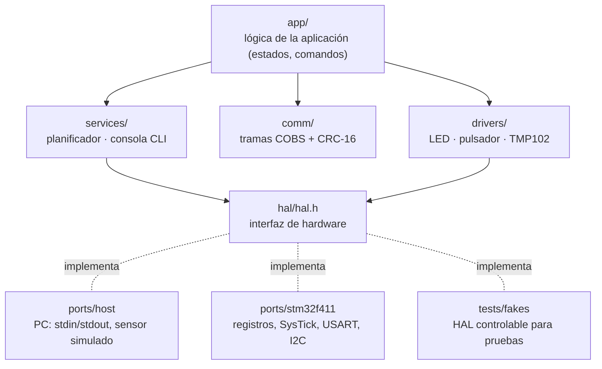

# Firmware Starter Kit — arquitectura modular para microcontroladores

Plantilla base para empezar un firmware **ordenado, portable y probado desde el
primer día**. Incluye una aplicación de ejemplo: un monitor de temperatura con
alarma, consola por UART y telemetría binaria.



**Regla de dependencias:** cada capa solo usa las de abajo, y solo los
`ports/` tocan el hardware. Así:

- la lógica se **ejecuta y depura en el PC** (`ports/host`), sin placa;
- las pruebas sustituyen el hardware por un **HAL falso** con el que controlan
  el tiempo, la UART y el I2C;
- **portar a otro MCU** solo requiere escribir `ports/<mcu>/`, unas 200
  líneas.

## Estructura

```
firmware-starter/
├── src/
│   ├── hal/hal.h              # contrato con el hardware
│   ├── drivers/               # LED con patrones, pulsador con antirrebote, TMP102 (I2C)
│   ├── services/              # planificador cooperativo con estadísticas, consola CLI
│   ├── comm/                  # COBS + CRC-16/CCITT para telemetría binaria
│   ├── app/                   # estados NORMAL / ALARMA / FALLA_SENSOR, comandos
│   └── main.c                 # 10 líneas: init + bucle del planificador
├── ports/
│   ├── host/                  # Linux/macOS
│   └── stm32f411/             # Blackpill: arranque, vectores, linker script, registros
├── tests/                     # Unity + HAL falso
├── cmake/                     # toolchain arm-none-eabi
└── CMakePresets.json          # host · host-asan · stm32f411
```

## Uso

```bash
# PC: compilar, probar y ejecutar
cmake --preset host-asan && cmake --build --preset host-asan && ctest --preset host-asan
cmake --preset host && cmake --build --preset host && ./build/host/firmware
```

```
firmware-starter 1.0.0 en host. Escribe help.
> status
estado=NORMAL temperatura=30.68 C errores=0 uptime=1305 ms plataforma=host
> tasks
tarea       periodo    ejec.   max_ms  atrasos
led              10      131        0        0
console          10      130        0        0
sensor         1000        2        0        0
```

```bash
# STM32F411 (requiere gcc-arm-none-eabi)
cmake --preset stm32f411 && cmake --build --preset stm32f411
# → build/stm32f411/firmware.{elf,bin,hex}:  FLASH 14.5 KB · RAM 2.9 KB
st-flash write build/stm32f411/firmware.bin 0x08000000
```

**Conexiones en la Blackpill:**
- LED: PC13.
- Pulsador KEY: PA0. Activa o desactiva la telemetría binaria.
- Consola: USART2 en PA2/PA3 a 115 200 baudios, con un adaptador USB-serie.
- TMP102: I2C1 en PB8 (SCL) y PB9 (SDA).

> El port del STM32F411 se compila en la CI, pero **no se ha probado en una
> placa**. La lógica de todas las capas sí está probada en el PC.

## Calidad automatizada

| Herramienta | Qué hace |
|---|---|
| `-Wall -Wextra -Wpedantic -Wconversion -Wsign-conversion -Werror` | Advertencias estrictas en todo el código propio |
| `clang-format` | Formato único (`.clang-format`); la CI falla si hay archivos sin formatear |
| `clang-tidy` | Análisis estático: bugprone, clang-analyzer, cert, performance |
| AddressSanitizer + UBSan | Las pruebas en el PC detectan accesos inválidos y comportamiento indefinido |
| Pruebas Unity | Tramas (vectores de referencia, 200 casos aleatorios, corrupción), TMP102 (valores de la hoja de datos), planificador (desborde de 32 bits y detección de atrasos), consola, máquina de estados con histéresis y falla del sensor |
| Compilación cruzada | `arm-none-eabi-gcc` en cada *push*, con reporte de memoria y artefactos `.elf/.bin/.hex` |

## Cómo extender

- **Nuevo sensor:**
  1. Crea `src/drivers/<sensor>.c` usando solo `hal_i2c_write_read()`.
  2. Prueba la conversión con valores de la hoja de datos en `tests/`.
- **Nueva tarea:** `sched_add("nombre", funcion, periodo_ms, desfase_ms)`. Las
  tareas no deben bloquear; consulta `tasks` para ver el tiempo máximo de
  cada una.
- **Nuevo MCU:**
  1. Copia `ports/stm32f411` y reemplaza los registros.
  2. Agrega el `PORT` en `CMakeLists.txt` y un *preset*.
- **RTOS:** cada tarea del planificador se convierte en una tarea de FreeRTOS
  sin cambiar drivers ni servicios.
